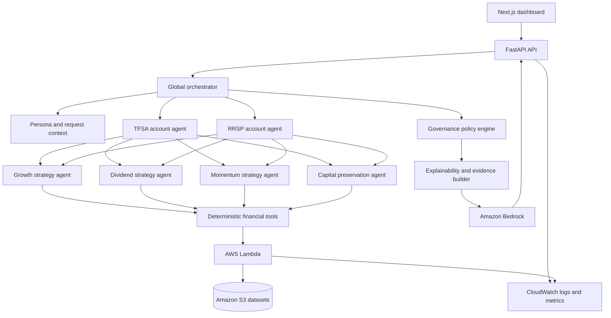

# PortfolioGuard AI implementation plan

**Status:** AWS Lambda vertical slice and demo workspace verified; awaiting Bedrock-test approval
**Audit date:** 2026-11-14
**Repository baseline:** post-`dev` merge at `09bd41b`
**Implementation branch:** `nicolas-implementation`
**Product boundary:** Fictional portfolios and hypothetical analysis only. No real transactions or personalized financial advice.

## Implementation progress — 2026-11-14

This plan remains the architectural reference. Implementation is deliberately
ordered around the approved first demo instead of completing every advanced metric
before an end-to-end AWS proof.

| Area | State | Evidence |
| --- | --- | --- |
| Global → account → strategy hierarchy | Implemented locally | Typed agents and an observable parent/delegation trace; TFSA and RRSP delegation tests |
| Deterministic financial tool | Implemented locally | S3-backed Lambda operation `compare_strategy_shift`; manifest checksum verification, golden calculation, and data-quality tests |
| First demo scenario | Implemented locally | 20-point TFSA growth-to-dividend comparison with volatility, drawdown, historical return, total return, concentration, and performance series |
| Governance and explainability | Implemented locally | Deterministic rules plus schema-validated Bedrock Converse response restricted to supplied evidence IDs |
| Dashboard | Implemented and visually verified | Landing page hands persona context to the app-like `/dashboard`; one API client drives readiness, chat, accounts, Lambda-backed metrics, Bedrock explanation, trace, governance, assumptions, limitations, and sources |
| Conversational demo workspace | Implemented locally | Approval-gated fictional account creation, profile route, FAQ and historical macro flow, local CORS coverage, and visible session-only/simulation boundaries |
| AWS infrastructure | Deployed and verified live | `portfolioguard-workshop` is `CREATE_COMPLETE`; versioned S3 integrity passed; one bounded Lambda run read S3 and matched all local metrics and 93 performance points exactly |
| Real AWS acceptance | Lambda passed; Bedrock pending | Live Lambda request `dc653658-6c96-40fd-9310-f616a0b1e086` matched the deterministic local engine exactly; no Bedrock call has occurred |
| Advanced analytics | Deferred | VaR/CVaR, deeper momentum analytics, and monitoring dashboards follow the working vertical slice |
| Submission package | Drafted | README, technical documentation, one-pager, and timed demo script are present; final screenshots and live AWS identifiers follow deployment |

The post-merge integration repair keeps `/` as the presentation landing page and
uses `/dashboard` as the only operational demo surface. The landing CTA passes the
selected persona and requests the primary live analysis. The workspace reports
configuration readiness without calling AWS, marks services verified only after a
successful end-to-end response, and fails closed without placeholder metrics.

Current deterministic fixture result for the primary window (2023-11-13 through
2026-11-12, 738 common observations): volatility 18.48% → 13.71%, maximum drawdown
-19.72% → -15.53%, and historical annualized return 30.80% → 27.42%. This is a
historical comparison and not a prediction.

## 1. Product objective

PortfolioGuard AI will compare a fictional investor's current and hypothetical portfolios across TFSA and RRSP accounts. It will calculate historical performance and risk deterministically, apply persona and account constraints, and use Amazon Bedrock to turn verified evidence into a concise explanation. Every result will expose its sources, calculation window, assumptions, warnings, governance decisions, and agent execution trace.

The approved primary demo question is:

> Would moving 20% of my TFSA from my growth strategy into my dividend strategy reduce my risk?

This question is implemented first for all three personas while the architecture remains capable of TFSA, RRSP, and combined-account comparisons.

## 2. Challenge requirements that drive the design

The official brief and participant deck establish these priorities:

- AWS must make a real and demonstrable contribution or the project is not eligible.
- The solution must be agentic and self-explaining, but the number of agents is not a goal by itself.
- Facts, assumptions, fictional scenarios, uncertainty, and limitations must remain visibly distinct.
- Historical results may describe risk and suitability but must not be presented as future-return predictions.
- Deliverables are a working prototype and source repository, a roughly five-minute demo, concise technical documentation, and a one-page summary.
- Simplified judging weights are: solution 20%, agentic architecture and explainability 20%, data 20%, UX/UI 10%, AWS 15%, and pitch/business value 15%.

## 3. Audit baseline (preserved for reference)

### Repository audit baseline

- At audit start, the worktree was clean on `main` and matched `origin/main`; the progress table above records changes made since that baseline.
- The repository contains a Next.js frontend, FastAPI backend, Lambda package, upload script, challenge documents, and the AlphaForge starter dataset.
- The project Wiki documents an earlier horizon-based architecture: long-term, mid-term, and short-term agents with nine strategy agents.
- There is no infrastructure-as-code, CI workflow, automated test suite, deployment manifest, architecture decision log, or production operations guide.

### Frontend

Implemented:

- Three-persona selector for Amira, Mateo, and Robert.
- Question form, API client, basic result view, warnings, and a simple agent trace.
- Simulation-only disclaimer.

Missing:

- Account and holdings input for TFSA and RRSP.
- Current-versus-hypothetical portfolio comparison.
- Performance, drawdown, risk, allocation, currency, sector, and concentration charts.
- Evidence citations, assumption display, governance status, calculation window, and uncertainty UI.
- Loading recovery, empty states, accessible chart descriptions, responsive dashboard layout, and frontend tests.

### Backend and agents

Implemented:

- FastAPI application with `/health` and `/api/chat`.
- Persona constants and a common agent result schema.
- File structure for an orchestrator, profile, risk, signals, horizon agents, strategy agents, governance, and explainability.

Missing:

- The orchestrator returns `Not implemented yet`.
- Most agent modules contain only a module docstring.
- TFSA and RRSP account agents do not exist.
- There is no structured orchestration state, tool registry, Bedrock prompt contract, evidence model, policy engine, or output validation.
- Mutable Pydantic defaults should be replaced with `Field(default_factory=...)` as part of the first backend change.

### AWS integration

Implemented:

- A Boto3 Bedrock Runtime client factory.
- A Boto3 Lambda invocation helper.
- An S3 sync shell script.
- Environment placeholders for region, model, Lambda function, and bucket.

Missing:

- No Bedrock request is made.
- The Lambda handler returns an error for every operation.
- No data has been staged under the ignored local `data/` path used by the upload script.
- No deployed S3 bucket, Lambda function, IAM roles/policies, CloudWatch dashboards/alarms, log correlation, or deployment outputs are defined in the repository.
- No infrastructure template proves or reproduces the claimed AWS architecture.

### Data

Available starter data:

- 31 assets across Canadian and U.S. equities, equity and bond ETFs, gold, Bitcoin, and Ether.
- 40,049 daily price rows from 2021-11-12 through 2026-11-12.
- 658 corporate-action rows, 1,245 USD/CAD observations, and 8,281 observations across nine macro series.
- Source metadata and a reproducible dataset builder.
- The supplied quality report says the current build found no warnings; the audit also found no fully duplicated rows or nulls in the analytical market files.

Known constraints that must be enforced or disclosed:

- Listing currencies differ and require dated USD/CAD conversion.
- Trading calendars are not aligned; crypto trades daily and market holidays differ.
- Adjusted close must be used for total-return calculations, and recorded splits must not be applied again.
- Monthly macro observations use reference dates rather than release dates, so they are unsafe for a look-ahead-free backtest without publication-date handling.
- The universe has survivorship bias and was selected in 2026.
- ESG scores, controversy data, fundamentals, and news are absent.
- The suspicious CNQ 1.021 action requires independent verification before use as a split.

### Verification state at audit

- All 34 Python source files parse successfully.
- The frontend package manifests parse successfully.
- There are no test files or CI workflows.
- Frontend dependencies are not installed in the current checkout, so lint and production build have not yet been executed.
- No live AWS call or deployment has been attempted during this audit.

## 4. Target architecture



### Agent responsibilities

| Component | Responsibility | May generate numbers? |
| --- | --- | --- |
| Global orchestrator | Classify intent, create a typed execution plan, call account agents, merge results, enforce completion checks | No |
| TFSA account agent | Apply fictional TFSA policy constraints and account-level allocation objectives | No |
| RRSP account agent | Apply fictional RRSP policy constraints and account-level allocation objectives | No |
| Growth strategy agent | Evaluate diversified growth exposure, technology concentration, and growth scenarios | No |
| Dividend strategy agent | Evaluate dividend history and income contribution from supplied corporate actions | No |
| Momentum strategy agent | Evaluate transparent trailing-return and trend rules without forecasting | No |
| Capital preservation strategy agent | Evaluate drawdown, volatility, bond/gold exposure, and near-horizon loss sensitivity | No |
| Financial Lambda | Read versioned S3 data and calculate all portfolio and asset metrics | Yes, deterministically |
| Governance | Apply hard rules, persona constraints, simulation boundaries, data sufficiency checks, and conflict flags | Only policy scores derived from explicit rules |
| Explainability | Assemble evidence packets and ask Bedrock to verbalize only supplied facts | No |

The existing horizon and extra strategy modules will be retired or adapted deliberately. They will not remain as decorative agents.

## 5. Evidence and response contract

Every analysis response will include:

- `analysis_id` and correlated AWS request IDs.
- Persona, account context, current portfolio, hypothetical portfolio, and comparison window.
- Deterministic metrics with units, formulas/version, currency basis, and source object/version.
- Account-agent and strategy-agent findings in typed structures.
- Governance decisions with rule IDs, severity, evidence references, and remediation text.
- A concise Bedrock explanation grounded only in the evidence packet.
- Assumptions, limitations, warnings, and an observable execution trace.
- A mandatory simulation-only and no-financial-advice notice.

Bedrock output is parsed against a typed schema. Unsupported evidence references,
missing citations, malformed output, or numeric claims fail closed and produce a
clear service error. The production path does not replace an invalid Bedrock result
with a fixture, mocked response, or unlabeled local substitute.

## 6. Deterministic calculation scope

Initial Lambda operations:

1. `validate_portfolio`
   - Holdings, weights, supported tickers, currencies, duplicates, and total-weight checks.
2. `portfolio_snapshot`
   - Asset, class, sector, currency, account, and concentration exposures.
3. `performance_comparison`
   - Total return, annualized return when the window permits, and cumulative return series using adjusted close.
4. `risk_comparison`
   - Annualized volatility, downside deviation, maximum drawdown, historical VaR/CVaR with stated confidence, and correlation.
5. `income_analysis`
   - Historical distributions and portfolio income contribution using corporate actions.
6. `momentum_signals`
   - Explicit 3-, 6-, and 12-month trailing returns and moving-average state. These are descriptive signals, not forecasts.
7. `scenario_compare`
   - Current versus hypothetical portfolio deltas, including contribution by holding and governance rule impacts.

Calculation policies:

- Use adjusted close for returns.
- Convert USD assets to CAD using same-day FX or the last prior available FX observation, and disclose the fill rule.
- Use an explicit common calendar and rebalance convention per operation.
- Reject insufficient history rather than silently shorten a requested window.
- Do not use reference-dated monthly macro data in historical signal decisions until publication dates or a conservative lag policy are implemented.
- Version calculation formulas and include unit tests with hand-computed fixtures.

## 7. AWS design

The first functional vertical slice will use real AWS services:

- **Amazon S3:** private, encrypted, versioned storage for immutable input datasets and optional analysis artifacts. Block all public access.
- **AWS Lambda:** packaged deterministic calculation service reading only the required S3 prefix. Use reserved safeguards and bounded memory/timeout settings.
- **Amazon Bedrock:** one configurable text model through the Converse API for grounded synthesis. Model selection remains configuration, not code.
- **IAM:** separate least-privilege execution roles for the calculation Lambda and local/backend caller. No long-lived keys in the repository or chat.
- **Amazon CloudWatch:** structured logs, request correlation, custom metrics, alarms for Lambda errors/throttles and Bedrock validation failures, and a small operational dashboard.
- **Infrastructure as code:** AWS SAM/CloudFormation template with parameterized names, tags, retention settings, and outputs. A deployment script will show the change set before applying it.

The local FastAPI service will call the deployed Lambda and Bedrock endpoints during development. This proves real integration from the first working feature while keeping frontend iteration local. Hosting the application itself on AWS is a later, separately approved deployment decision.

## 8. Implementation phases and acceptance criteria

### Phase 0: Baseline and AWS approval gate

Deliverables:

- Adopt this plan and add architecture decision records.
- Add backend/frontend test scaffolding, formatting, linting, and CI that does not require live AWS credentials.
- Add configuration validation and local developer commands.
- Define the SAM template and least-privilege policies without deploying them.
- Produce a CloudFormation change set and cost/cleanup summary for approval.

Acceptance criteria:

- Clean local checks and documented commands.
- No secrets in source control.
- No AWS resources created before explicit approval.

### Phase 1: Real AWS vertical slice

Deliverables:

- Deploy approved S3, Lambda, IAM, and CloudWatch resources.
- Upload the reviewed starter dataset with hashes and a manifest.
- Implement `validate_portfolio`, `portfolio_snapshot`, and `risk_comparison` in Lambda.
- Invoke Lambda from FastAPI and invoke Bedrock with a schema-validated evidence packet.
- Log one end-to-end analysis with a shared correlation ID.

Acceptance criteria:

- An integration test calls the real deployed Lambda and verifies deterministic fixture results.
- A Bedrock response cites only evidence IDs supplied in the request.
- CloudWatch shows the end-to-end request and no raw confidential data or credentials.

### Phase 2: Hierarchical agent core

Deliverables:

- Typed orchestration state and agent interface.
- Global orchestrator, TFSA agent, RRSP agent, and the four required strategy agents.
- Persona policies for Amira, Mateo, and Robert.
- Deterministic governance engine and explainability evidence graph.

Acceptance criteria:

- Each agent has a necessary, testable role.
- Robert's high-volatility request triggers a visible profile conflict.
- Amira's aggressive scenario still triggers diversification controls when concentrated.
- Mateo's ESG request reports insufficient controversy evidence instead of inventing an ESG conclusion.

### Phase 3: Full financial comparison engine

Deliverables:

- Complete calculation operations listed above.
- Current-versus-hypothetical comparisons for TFSA, RRSP, and combined portfolios.
- Currency, calendar, missing-data, and rebalance policies.
- Golden fixtures, property tests, and edge-case coverage.

Acceptance criteria:

- Independent local reference calculations match Lambda within documented tolerances.
- No metric can originate from the LLM.
- Data provenance and formula versions are present in every metric.

### Phase 4: Dashboard

Deliverables:

- Portfolio editor with fictional presets for all three personas.
- Account tabs, comparison charts, risk metrics, allocation views, evidence drawer, governance flags, and agent trace.
- Accessible responsive states and error recovery.

Acceptance criteria:

- A user can complete a full comparison without editing JSON.
- Every headline result links to its calculation evidence and limitations.
- Frontend unit/component tests and a production build pass.

### Phase 5: Hardening and evaluation

Deliverables:

- Prompt-injection and unsupported-claim tests.
- AWS failure-mode handling, retry policy, timeouts, idempotency, and observability.
- Performance and cost measurements for the demo path.
- Three persona regression scenarios and two contrasting end-to-end demo scenarios.

Acceptance criteria:

- Tests cover calculation correctness, governance boundaries, and explanation grounding.
- The application degrades clearly when AWS or data is unavailable.
- CloudWatch alarms and cleanup instructions are verified.

### Phase 6: Submission package

Deliverables:

- Final README with prerequisites, secure AWS setup, deployment, local development, testing, architecture, data, and teardown.
- Technical documentation with agent interactions, methods, sources, controls, validation, limitations, and improvements.
- One-page project summary.
- Approximately five-minute demo script and recording checklist.
- Final architecture diagram and rubric coverage matrix.

Acceptance criteria:

- A new reviewer can reproduce the approved deployment and demo from the documentation.
- The demo shows real Bedrock, Lambda, S3, IAM, and CloudWatch contributions.
- All fictional/simulation boundaries remain visible.

## 9. Testing strategy

- **Unit tests:** calculation formulas, validation, account policies, governance rules, response schemas, and explanation evidence checks.
- **Golden tests:** small portfolios with manually verified returns, drawdowns, FX conversion, dividends, and contribution deltas.
- **Property tests:** weights, invariants, missing data, calendar boundaries, and monotonic concentration checks.
- **Contract tests:** FastAPI request/response models and Lambda event/result schemas.
- **AWS integration tests:** opt-in tests against the approved deployed stack, marked separately from local tests.
- **Frontend tests:** persona/account flows, comparison rendering, warnings, evidence navigation, and failure states.
- **End-to-end tests:** fixed fictional scenarios for Amira, Mateo, and Robert.

Live AWS tests will never be silently substituted with mocks. Local unit tests may use deterministic fakes to test failure handling, while acceptance of AWS integration requires separate tests against real services.

## 10. Planned repository structure

```text
backend/
  app/
    agents/
      accounts/
      strategies/
      orchestrator.py
      governance.py
      explainability.py
    domain/
    api/
    services/
    observability/
  tests/
frontend/
  src/
  tests/
lambda/
  financial_tools/
  tests/
infra/
  template.yaml
  policies/
data/
  README.md
  manifests/
docs/
  adr/
  architecture/
  IMPLEMENTATION_PLAN.md
  TECHNICAL_DOCUMENTATION.md
  ONE_PAGER.md
  DEMO_SCRIPT.md
scripts/
```

## 11. Decisions and assumptions requiring confirmation

1. **AWS account and region:** use the organizer-provided Polyfinances 2026 Workshop Studio account in `us-east-1`; console access is confirmed and the session lasts 72 hours.
2. **Bedrock model:** use the system-defined US Amazon Nova Lite profile `us.amazon.nova-lite-v1:0`. Invocation still requires confirmation that the workshop role and organization controls allow routing to `us-east-1`, `us-east-2`, and `us-west-2`.
3. **Deployment approval:** the reviewed `portfolioguard-workshop` stack is deployed with the approved S3 bucket, Lambda, least-privilege execution role, and CloudWatch log group. The dataset upload and one bounded Lambda acceptance run were separately approved and completed. Bedrock has not been invoked and still requires explicit approval.
4. **Credentials:** use Workshop Studio's temporary AWS CLI credentials through the standard AWS credential chain and a local named profile. Never request or store their values in source, logs, screenshots, or chat.
5. **Workshop IAM:** read-only IAM simulation on 2026-11-14 confirmed role lifecycle, `iam:PassRole`, CloudFormation, S3, Lambda, Logs, and Bedrock actions for `WSParticipantRole`. No suitable existing application execution role exists, so the stack creates one unnamed least-privilege Lambda role under `CAPABILITY_IAM`. Simulations are strong preflight evidence, not a substitute for reviewing the change set or the separately approved live Bedrock invocation.
6. **Portfolio assumptions:** the challenge supplies personas but not holdings or contribution room. Demo holdings and account balances will be explicitly fictional and versioned in the repository.
7. **Tax/account rules:** TFSA/RRSP logic will remain a transparent policy layer backed by authoritative Canadian sources and will not calculate personal eligibility, contribution room, or tax advice.
8. **ESG:** Mateo's flow will disclose that controversy-level evaluation is unavailable until an approved public ESG evidence source is added.

## 12. Primary risks and mitigations

| Risk | Mitigation |
| --- | --- |
| Decorative multi-agent design | Typed inputs/outputs, one clear responsibility per agent, and tests proving each agent changes the workflow |
| LLM invents financial figures | Numeric firewall: all metrics originate in Lambda, evidence IDs are validated, unsupported Bedrock claims are rejected |
| Look-ahead or survivorship bias | Explicit data window, conservative macro policy, reproducible manifests, and visible limitations |
| Misleading account/tax claims | Narrow fictional policy rules, authoritative citations, no contribution-room or personalized tax calculations |
| AWS costs or accidental deployment | Change-set review, tags, budgets/alarms where available, bounded resources, explicit approval, and teardown script |
| Demo failure due to external services | Preflight health page, clear AWS error states, idempotent requests, and a recorded evidence packet for presentation backup that is labeled as a prior real run |
| Scope expansion | Prioritize the complete comparison workflow and judging rubric before optional signals, news, or additional assets |

## 13. Definition of project complete

The project is complete when:

- A reviewer can choose any of the three fictional personas, edit TFSA/RRSP holdings, create a hypothetical allocation, and receive a deterministic comparison.
- The required hierarchy of orchestrator, account agents, strategy agents, governance, and explainability is observable and testable.
- Real Bedrock, Lambda, S3, IAM, and CloudWatch integration is deployed with approval and demonstrated end to end.
- Financial calculations are reproducible, source-backed, currency-aware, and covered by tests.
- The dashboard exposes risks, evidence, assumptions, limitations, and governance conflicts without implying future performance or financial advice.
- Local tests, AWS integration tests, frontend build, and end-to-end persona scenarios pass.
- README, technical documentation, one-pager, and demo script are ready for submission.
